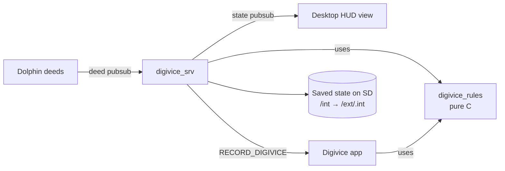

# Flipper Digivice

A virtual pet that lives inside the official Flipper Zero firmware: it grows with the way you actually use your Flipper.

[](https://github.com/pausf/flipper-digivice/actions/workflows/digivice.yml)


[](LICENSE)

## What it is

A fork of [flipperdevices/flipperzero-firmware](https://github.com/flipperdevices/flipperzero-firmware) (base: official `dev`) that replaces the home-screen dolphin with a digital pet. Every stock feature is kept. Pet names and art are original: no licensed Digimon names or artwork are used, and all sprites are drawn procedurally.

## ✨ Features

- **Care**: hunger and mood decay over time (awake hours only), feed and train your pet.
- **Corruption instead of death**: neglect makes the pet glitch and eventually turn into VIRUBYTE. A clean day restores it. Nothing is ever lost.
- **7 forms**: Byteegg, Bitling, Bytemon, then a Champion decided by what you use most:

  | Usage type | Champion |
  | --- | --- |
  | NFC / RFID / iButton | Tagdrake |
  | Sub-GHz | Wavedrake |
  | Infrared | Beamdrake |
  | USB / BadUSB / U2F | Plugdrake |

- **VIRUX**: scanning with NFC, RFID, iButton or Sub-GHz can spawn a hostile VIRUX for 30 minutes.
- **Turn-based battle**: attack with a timing bar, defend, or flee. Types beat each other in a cycle (NFC > USB > IR > Sub-GHz > NFC).
- **HUD-cyber UI**: 1-bit, monochrome, scanlines and glitch effects.
- **Feedback**: RGB LED, vibration and buzzer (silent during sleep hours, 23:00 to 07:00).

## 🏗️ Architecture



| Path | Role |
| --- | --- |
| `applications/services/digivice/digivice_rules.[ch]` | All game logic, pure C, no furi includes |
| `applications/services/digivice/digivice_config.h` | Every tuning number |
| `applications/services/digivice/digivice_srv.c` | Service: persistence, ticks, deed hook, state pubsub |
| `applications/services/digivice/digivice_draw.[ch]` | Procedural 1-bit drawing kit (forms, VIRUX, cutscene) |
| `applications/services/digivice/digivice_notify.[ch]` | LED, vibration and buzzer feedback |
| `applications/services/digivice/test/` | Host-side rules test and `run.sh` |
| `applications/main/digivice/` | App: menu, feeding, training, stats, battle |
| `applications/services/desktop/views/desktop_view_digivice.c` | Home-screen HUD |
| `applications/services/dolphin/` | Publishes completed deeds on a dedicated pubsub |

## 🔧 Build and install

**a) Prebuilt**: download the `digivice-update-package` artifact from the latest run of the [CI workflow](https://github.com/pausf/flipper-digivice/actions/workflows/digivice.yml).

**b) From source** (fbt downloads its own toolchain):

```sh
./fbt COMPACT=1 DEBUG=0 updater_package      # full package: firmware, radio stack, resources
./fbt COMPACT=1 DEBUG=0 updater_minpackage   # firmware only
```

The output lands in `dist/f7-C/f7-update-local/` (plus a `.tgz` next to it).

**c) Install**, any of:

- USB: `./fbt COMPACT=1 DEBUG=0 flash_usb_full`
- qFlipper: *Install from file* with the update package
- No USB: copy the `f7-update-*` folder to the SD card, then open its `update.fuf` from the Archive app

> Warning: updating from the official mobile app reinstalls the stock firmware and removes the digivice.

## 🎮 Controls

| Where | Key | Action |
| --- | --- | --- |
| Home | Right (short) | Open the digivice, unless you set a Right favourite in Settings |
| Home | Other keys | Unchanged: OK menu, Up lock, Down Archive, Left and long presses favourites, long Back power |
| Menu | Up / Down | Move (Feed, Train, Stats, Battle) |
| Menu | OK / Back | Select / leave |
| Training | OK | Stop the meter inside the zone |
| Battle | Left / Right, OK | Choose Attack, Defend or Flee |
| Battle (aim) | OK | Fire when the cursor is in the zone: x1.5 inside, x0.5 outside |
| Battle (end) | OK or Back | Return to the menu |

Battle is only available while a VIRUX is pending.

## ✅ Tests

```sh
applications/services/digivice/test/run.sh
```

Builds the pure rules with the host `cc` and prints `digivice_rules: all checks passed`.

CI (`.github/workflows/digivice.yml`) runs on push and pull request to `main`:

1. `rules-tests`: the host test above.
2. `firmware`: builds `updater_package` and uploads `digivice-update-package`.

The upstream workflows were removed: they need Flipper Devices secrets.

## 🎛️ Tuning

Decay rates, corruption, evolution thresholds, spawn chance, battle numbers and timings all live in [`applications/services/digivice/digivice_config.h`](applications/services/digivice/digivice_config.h).

## 🚧 Status and known limitations

- Not yet verified on a physical device. The rules are host-tested; the full firmware build runs in CI.
- Parked items:
  - The HUD stays paused after Apps then Back until a key press.
  - The hidden animation manager keeps running.
  - The SD "no database" notice is not shown.

## Credits

Based on [flipperdevices/flipperzero-firmware](https://github.com/flipperdevices/flipperzero-firmware), licensed under GPL-3.0 (see [LICENSE](LICENSE)). The digivice code is released under the same license.

Design: [`docs/superpowers/specs/2026-10-13-digivice-design.md`](docs/superpowers/specs/2026-10-13-digivice-design.md). Plan: [`docs/superpowers/plans/2026-10-13-digivice.md`](docs/superpowers/plans/2026-10-13-digivice.md).
