# Flipper Digivice

A V-Pet that lives inside the official Flipper Zero firmware: it replaces the home-screen dolphin, grows with how you use your Flipper, and goes on expeditions and turn-based duels.

[](https://github.com/pausf/flipper-digivice/actions/workflows/digivice.yml)


[](LICENSE)

<p align="center">
  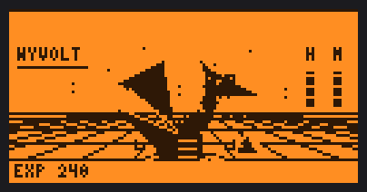
  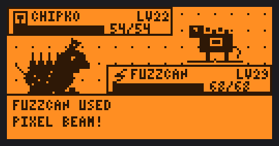
</p>

## Screenshots

Every image below is rendered by the **real firmware drawing code**, compiled on the host against a 128x64 1-bit canvas that runs the real u8g2 font renderer (see [Rendering the screenshots](#rendering-the-screenshots)). Nothing is mocked up by hand.

| | | |
| --- | --- | --- |
| 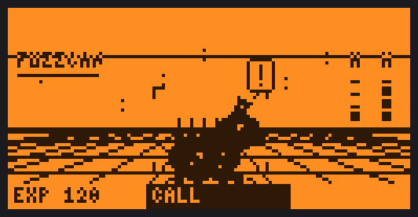 | 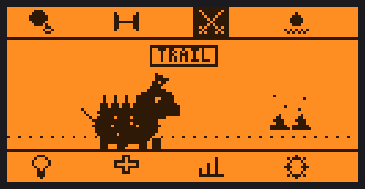 | 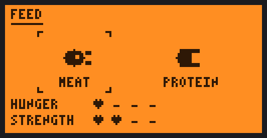 |
| Home HUD, with a hunger call | Icon menu | Feeding: pick a meal |
| 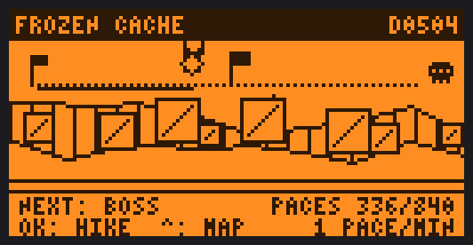 | 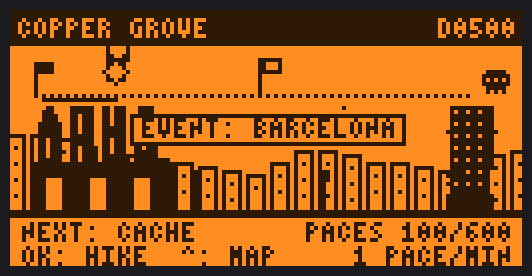 | 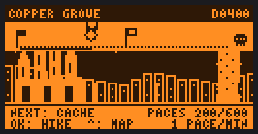 |
| Expedition trail, seeded scenery | City event: Barcelona | The same skyline at night |
| 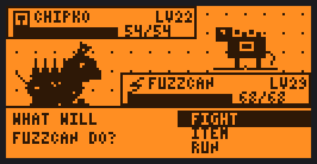 | 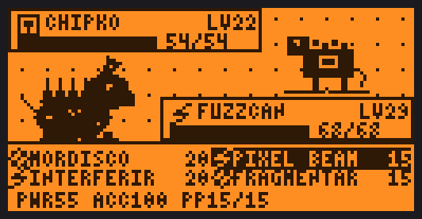 | 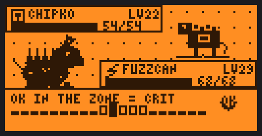 |
| Duel: FIGHT / ITEM / RUN | Four moves with PP | Timing bar for a critical hit |
| 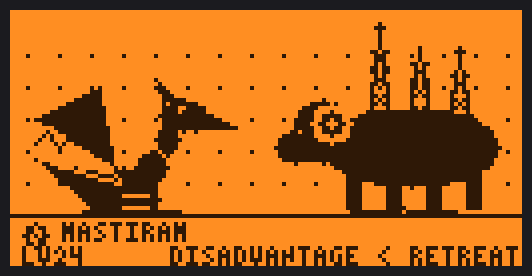 | 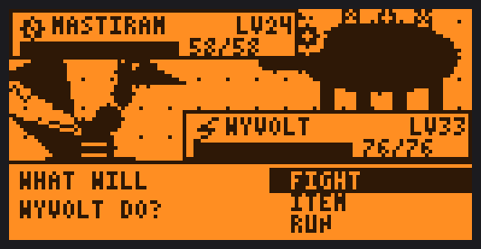 | 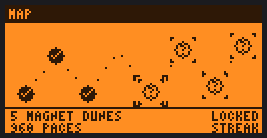 |
| Area boss lead-in | Boss duel | Eight-area map |
| 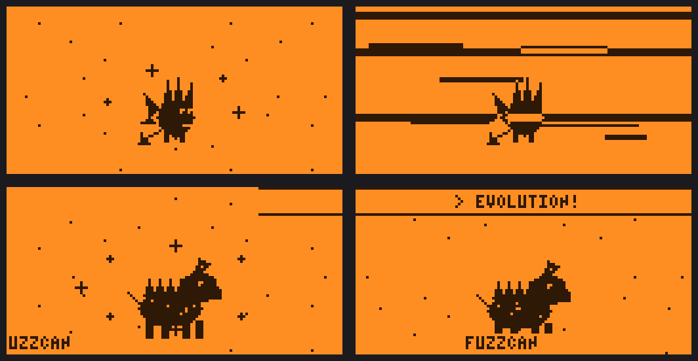 | 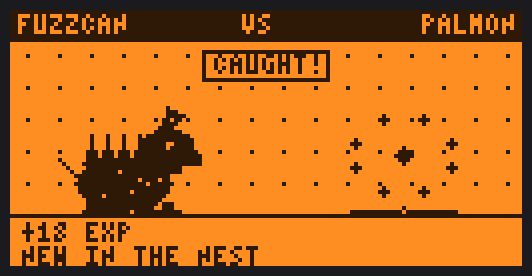 | 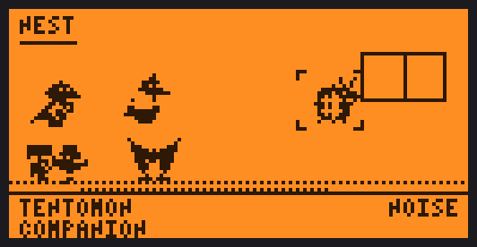 |
| Evolution cutscene (four frames) | Capturing a homage partner | The nest |

<details>
<summary>More: roster, monsters, partners, animations</summary>

**Bestiary** (28 monsters plus the egg):

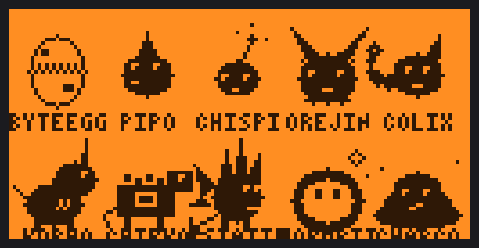
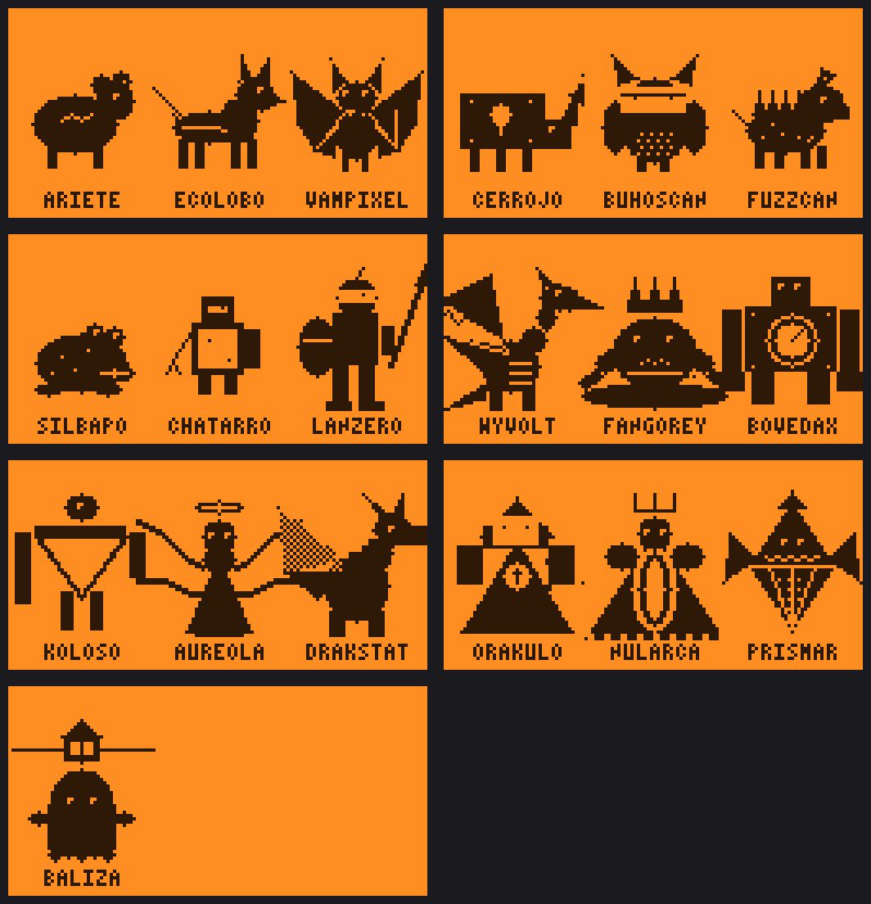

**Trail monsters, city monsters and area bosses:**

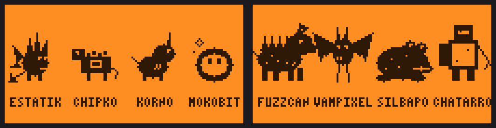
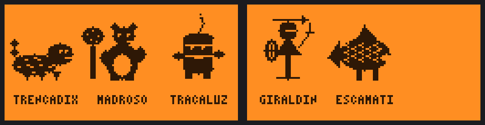
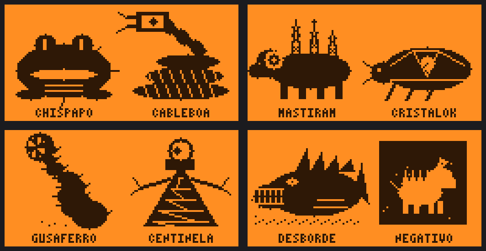

**Homage partners** (hand-drawn fan art, behind a build flag):

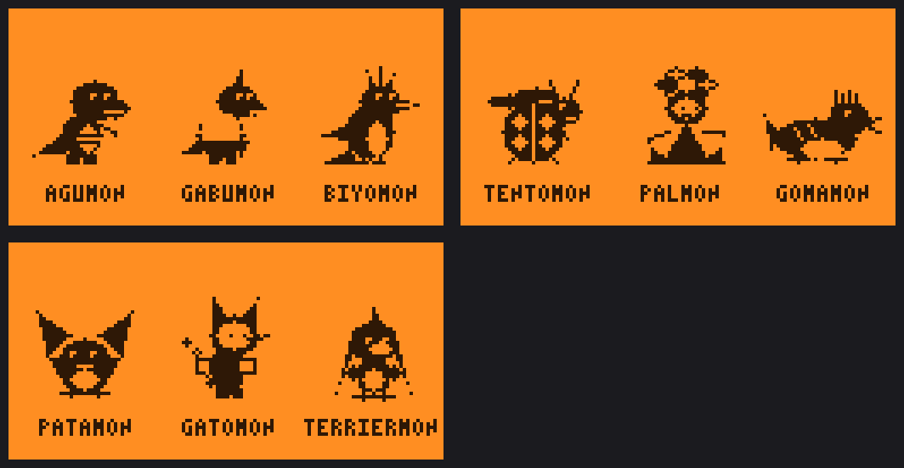

**Animations:** [feeding](docs/images/anim-feeding.gif), [trail walk](docs/images/anim-trail-walk.gif), [pet walking](docs/images/anim-pet-walk.gif), [evolution](docs/images/anim-evolution.gif), [battle intro](docs/images/anim-battle-intro.gif), [boss intro](docs/images/anim-boss-intro.gif), [partner capture](docs/images/anim-homage-capture.gif), [the nest](docs/images/anim-nest.gif).

**More stills:** [care needs](docs/images/shot-care-needs.png), [corruption glitch](docs/images/shot-corruption-glitch.png), [training](docs/images/shot-training.png), [profile](docs/images/shot-profile.png), [victory](docs/images/shot-battle-victory.png), [defeat](docs/images/shot-battle-defeat.png), [boss gate](docs/images/shot-boss-gate.png), [city monster duel](docs/images/shot-city-monster-battle.png), [companion walking beside the pet](docs/images/shot-companion-walk.png), [VIRUX on the home screen](docs/images/shot-home-hud-virux.png), [night](docs/images/shot-home-hud-night.png).

</details>

## What it is

A fork of [flipperdevices/flipperzero-firmware](https://github.com/flipperdevices/flipperzero-firmware) that puts a digital pet where the dolphin used to be. **Every stock Flipper feature is kept**: the pet is a system service plus one built-in app, and the desktop keeps its usual keys.

The pet reacts to what you do with the device (in Hacker mode), needs daily care, evolves through six stages, walks eight areas, and fights Pokemon-style turn-based duels. Monster names and art are original, and every sprite is drawn procedurally in code.

## Features

- **Care and calls.** Hunger, mood and strength hearts decay only while the pet is awake. It calls you when hungry or low on vigor, makes poop, can get sick, and sleeps from 23:00 to 07:00 (turn the light off). Meat and protein are separate meals. Neglect corrupts the pet and makes it glitch instead of dying; a clean day restores it.
- **28-monster evolution tree** with hidden counters: care mistakes, training, battles won, overfeeding and sleeping with the light on all steer which form it grows into.
- **Normal and Hacker modes.** Normal behaves like a store-bought V-Pet and ignores Flipper activity. Hacker turns your Flipper deeds into EXP and data, and can spawn a timed VIRUX to fight.
- **Expedition.** Eight areas, each with its own length, trail monsters, midway event (spring, cache or shortcut), boss and seeded procedural scenery (parallax layers, day, dusk and night from the clock). The pet walks one pace per awake minute, and a rhythm minigame, Hike, adds more.
- **Pokemon-style turn battles.** Pick FIGHT, ITEM or RUN. 26 moves with power, accuracy, PP and side effects, an attribute triangle (Portador > Ruido > Cifrado > Portador, Nulo neutral), a timing bar for critical hits, and a Shield item. Bosses guard areas, and areas 5 to 8 are streak areas with no retreat.
- **Homage partners (easter egg).** Hand-drawn fan-art partners appear as rare encounters, can be captured, live in the nest and walk beside the pet as a companion. This is all behind the `DIGIVICE_EASTER_EGGS` build flag (`-DDIGIVICE_EASTER_EGGS=0` compiles it out) and the main host suites also run with it off.
- **Spanish city events.** Pick Barcelona, Madrid, Valencia, Sevilla or Bilbao in Settings: the trail swaps to that city's skyline and its exclusive monster can appear.
- **Spanish and English.** Switch in Settings; the UI strings live in one table.
- **Feedback.** RGB LED, vibration and buzzer, silent during sleep hours.

## Controls

| Where | Key | Action |
| --- | --- | --- |
| Home | Right (short) | Open the Digivice app. Every other desktop key is stock. |
| Icon menu | Left / Right | Move along the icons |
| Icon menu | Up / Down | Jump between the top and bottom row |
| Icon menu | OK / Back | Use the icon / leave |
| Feeding | Left / Right, OK | Pick meat or protein, eat |
| Training | OK | Stop the meter inside the zone |
| Trail | OK | Act: fight, claim the midway event, open the boss, or start a Hike |
| Trail | Up / Back | Area map / back to the icon menu |
| Map | Left / Right, OK | Choose an area, travel |
| Hike | OK | Tap on the beat |
| Duel menu | Up / Down, OK | FIGHT, ITEM or RUN |
| Duel moves | Arrows, OK, Back | Choose a move, confirm, go back |
| Duel timing | OK | Lock the bar; inside the zone is a critical hit |
| Profile | Right / Left | Bestiary / nest |
| Settings | Up / Down, Left / Right | Choose a setting, change it (language, mode, city, reset) |

Icon menu order: Feed, Train, Trail (the crossed swords), Clean, Light, Cure, Profile, Settings.

## Architecture

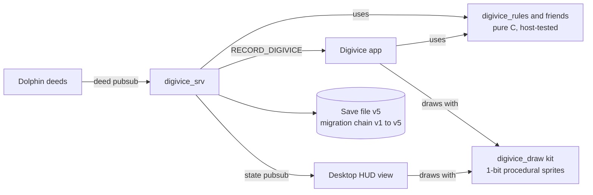

- **Service** (`applications/services/digivice/digivice_srv.c`): owns the state, ticks every minute, listens to dolphin deeds, saves it, and publishes a snapshot to the state pubsub. The app talks to it through blocking calls.
- **Rules** (`digivice_rules.c`, `digivice_expedition.c`, `digivice_duel.c`, `digivice_moves.c`, `digivice_evolution.c`, `digivice_homage.c`, `digivice_city.c`): pure C with no furi includes, so the host test compiles them with plain `cc`. Every tuning number lives in `digivice_config.h`.
- **Save format v5** (`.digivice.state` through `saved_struct`): each version is a frozen struct, and loading walks the migration chain v1 to v2 to v3 to v4 to v5, so an old save keeps its pet.
- **UI**: the desktop HUD (`desktop_view_digivice.c`) and the app (`applications/main/digivice/`) share the drawing kit in `digivice_draw*.c`.

## Technology used

- **C** (C11 for the host build, the Flipper toolchain for the device)
- **Flipper Zero SDK and furi** (services, pubsub, `saved_struct`, loader, notifications)
- **FreeRTOS** underneath furi, on the **STM32WB55**
- **u8g2** for the 1-bit canvas and the 4x6 font
- **fbt / SCons** for the firmware build
- **GitHub Actions** for CI (host tests, then the firmware update package)
- **Host tests** in plain C, with and without the easter-egg flag

## Build and flash

**Prebuilt.** Download the `digivice-update-package` artifact from the latest run of the [CI workflow](https://github.com/pausf/flipper-digivice/actions/workflows/digivice.yml).

**From source** (fbt downloads its own toolchain):

```sh
./fbt COMPACT=1 DEBUG=0 updater_package
```

The package lands in `dist/f7-C/f7-update-local/`, with a `.tgz` next to it.

**Install**, any of:

- USB with the script: `python3 scripts/selfupdate.py -p <serial-port> <path-to>/update.fuf`
- qFlipper: *Install from file*, with the update package
- SD card: copy the `f7-update-*` folder to the card, then open its `update.fuf` from the Archive app

> **Warning:** updating from the official Flipper mobile app or qFlipper's online channel reinstalls the stock firmware and removes the digivice.

## Testing

```sh
applications/services/digivice/test/run.sh
```

It builds the pure rules and the host suites with the system `cc` and runs them: rules, expedition, battle, roster, evolution, homage, city, moves, duel, and i18n. The suites that touch partners run twice, with and without `DIGIVICE_EASTER_EGGS`. The i18n check also keeps every digivice source ASCII-only (accents live as escapes in `digivice_i18n.c`).

CI (`.github/workflows/digivice.yml`) runs the host tests first, then builds `updater_package` and uploads it.

## Rendering the screenshots

`docs/tools/render/` compiles the real draw kit, the app's own draw and tick functions (feeding, trail, duel, bestiary, nest, evolution and so on) and the real u8g2 against a fake canvas and SDK shims, then encodes PNGs and GIFs with the Python standard library.

```sh
docs/tools/render/build.sh   # needs cc and python3; rewrites docs/images/
```

Images use the Flipper LCD palette (on `#2e1806`, off `#ff8e22`) and a small bezel. The roster and monster sheets are laid out by the renderer with the same draw calls the app uses, because the app shows one form at a time.

## Status and limitations

- Fan work and **non-commercial**. The Bandai-inspired homage partners are unofficial fan art: this project is not affiliated with, endorsed by or sponsored by Bandai or Toei Animation, and no official sprites are copied or traced. The partners are behind a build flag so a distribution can leave them out.
- Rendering, rules and the duel loop are host-verified; the device build is checked in CI. Behaviour on the real LCD, LED and buzzer is only as tested as your own device.
- Updating through the official channels removes the digivice (see the warning above).

## Documentation

- Design specs: [v1](docs/superpowers/specs/2026-10-13-digivice-design.md), [v2.1 care](docs/superpowers/specs/2026-10-14-digivice-v2-1-base-care-design.md), [v3.1 battle and Expedition](docs/superpowers/specs/2026-10-19-digivice-v3-1-battle-expedition-design.md)
- Plans: [v1](docs/superpowers/plans/2026-10-13-digivice.md), [v2.1](docs/superpowers/plans/2026-10-14-digivice-v2-1.md), [v3.1](docs/superpowers/plans/2026-10-19-digivice-v3-1.md), [v3.2](docs/superpowers/plans/2026-10-20-digivice-v3-2.md), [v3.3](docs/superpowers/plans/2026-10-20-digivice-v3-3.md), [v3.4](docs/superpowers/plans/2026-10-20-digivice-v3-4.md)
- Research: [V-Pet and Digivice study](docs/superpowers/research/2026-10-16-vpet-digivice-research.md)
- Status and handoff: [v3-status.md](docs/superpowers/v3-status.md)
- Design mockups (open in a browser): [bestiary](docs/superpowers/mockups/v3/v3-bestiario.html), [expedition](docs/superpowers/mockups/v3/v3-expedicion.html), [combat](docs/superpowers/mockups/v3/v3-combate.html), [care](docs/superpowers/mockups/v3/v3-cuidados.html), [cities](docs/superpowers/mockups/v3/v3-ciudades.html), [easter eggs](docs/superpowers/mockups/v3/v3-easter-eggs.html)

## Credits

Built on [flipperdevices/flipperzero-firmware](https://github.com/flipperdevices/flipperzero-firmware), licensed under GPL-3.0 (see [LICENSE](LICENSE)). The digivice code is released under the same license.
